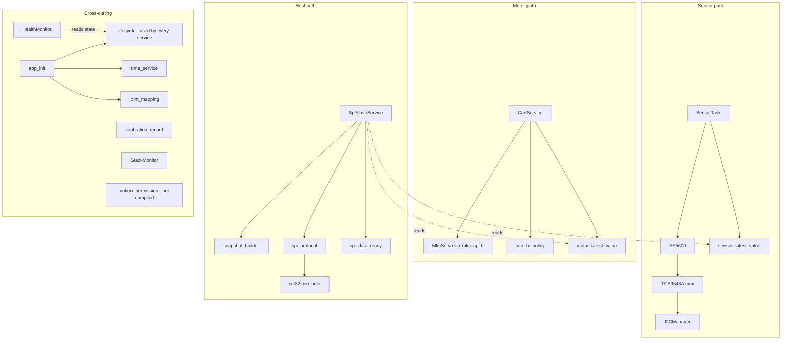
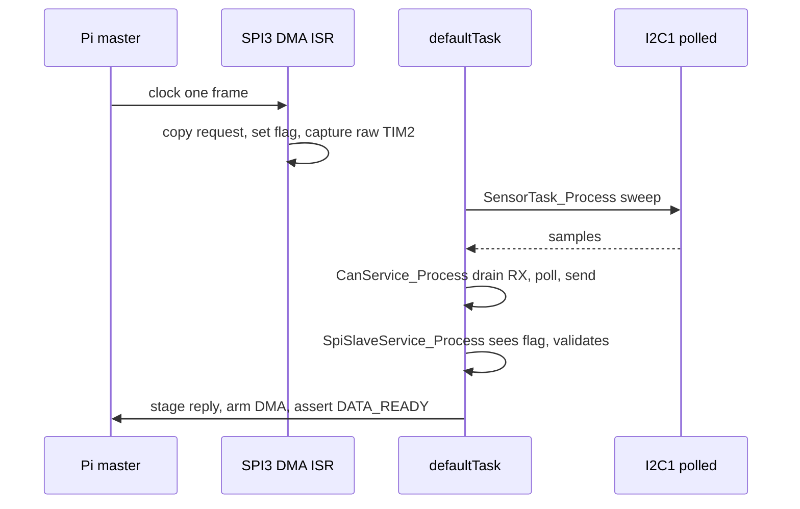
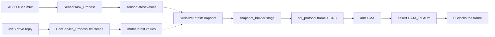

# Arm Sensor Hub Firmware Architecture

**Status:** As-built map of the firmware (2026-10-15, after WP9 stories B52 and B53), with planned changes marked. Component document: it is not a system requirement or an interface contract. Update it with any change to the module structure, task model, peripheral allocation or interrupt strategy.

## 1. Purpose and scope

This document maps the STM32F405 firmware: which modules exist, how they call each other, what runs in a task and what runs in an interrupt, how the peripherals are allocated, and where memory and configuration live. It is the owner of the service architecture, the FreeRTOS task structure, the DMA and interrupt strategy and the HAL configuration, as declared in [`README.md`](README.md).

It does not define system requirements, interface contracts or numeric values. Those stay with their owners:

- System role, architecture and lifecycle: [`ARM_SENSOR_HUB.md`](../../Documentation/03_COMPONENTS/ARM_SENSOR_HUB.md), [`SYSTEM_ARCHITECTURE.md`](../../Documentation/01_SYSTEM/SYSTEM_ARCHITECTURE.md), [`SYSTEM_LIFECYCLE.md`](../../Documentation/01_SYSTEM/SYSTEM_LIFECYCLE.md).
- Interfaces: [`SPI_SYSTEM_INTERFACE.md`](../../Documentation/02_INTERFACES/SPI/SPI_SYSTEM_INTERFACE.md), [`SPI_PAYLOAD_SCHEMA.md`](../../Documentation/02_INTERFACES/SPI/SPI_PAYLOAD_SCHEMA.md), [`CAN_SYSTEM_INTERFACE.md`](../../Documentation/02_INTERFACES/CAN/CAN_SYSTEM_INTERFACE.md), [`TIME_SYSTEM_INTERFACE.md`](../../Documentation/02_INTERFACES/TIME/TIME_SYSTEM_INTERFACE.md).
- Numbers: [`PARAMETER_REGISTER.md`](../../Documentation/06_CONFIGURATION/PARAMETER_REGISTER.md) (`PRM-*` rows) and [`SYSTEM_CONFIGURATION.md`](../../Documentation/06_CONFIGURATION/SYSTEM_CONFIGURATION.md). This document gives no numbers. It names the `.ioc` key, generated symbol or `PRM-*` row where each value lives.
- Decisions and rulings (R-numbers): [`ARCHITECTURE_DECISIONS.md`](../../Documentation/07_DECISIONS/ARCHITECTURE_DECISIONS.md).

Nothing here is `SYSTEM_VERIFIED`. Verification status is owned by the system verification matrix.

## 2. Module map

Application code is in `App/` ([`Inc`](../App/Inc/), [`Src`](../App/Src/)). The `MksServo` library is reached only through [`mks_api.h`](../Middlewares/Third_Party/MksServo/include/mks_api.h).

`calibration_record` and `joint_mapping` are data modules. `app_init` validates the joint mapping at start and registers the motors from it. `calibration_record` has no caller in the linked firmware today. `motion_permission` is in `App/` but is not in the firmware source list in [`CMakeLists.txt`](../CMakeLists.txt), so it is not compiled into the firmware. It is the one module exempted, with its reason, from the configure-time source-list check (B54); the gated-motion work that builds it is WP14.

| Module | Responsibility | Owning header | Contract |
|---|---|---|---|
| `app_init` | Initialise services in order, hold the commissioning tables, activate services once | [`app_init.h`](../App/Inc/app_init.h) | [`SYSTEM_CONFIGURATION.md`](../../Documentation/06_CONFIGURATION/SYSTEM_CONFIGURATION.md) |
| `i2c_manager` | Own I2C1: one mutex, polled transfers, atomic mux-select-then-read | [`i2c_manager.h`](../App/Inc/i2c_manager.h) | [`I2C_MANAGER_CONTRACT.md`](I2C_MANAGER_CONTRACT.md) |
| `tca9548a_mux`, `as5600` | Select a mux channel; read encoder registers and build a sample | [`tca9548a_mux.h`](../App/Inc/tca9548a_mux.h), [`as5600.h`](../App/Inc/as5600.h) | Vendor datasheets |
| `sensor_task` | Sweep the fitted axes, validate samples, write the latest values | [`sensor_task.h`](../App/Inc/sensor_task.h) | [`SYSTEM_CONFIGURATION.md`](../../Documentation/06_CONFIGURATION/SYSTEM_CONFIGURATION.md) |
| `can_service` | Own CAN1: filter, receive, poll scheduler, transmit, bus-off handling | [`can_service.h`](../App/Inc/can_service.h) | [`CAN_SYSTEM_INTERFACE.md`](../../Documentation/02_INTERFACES/CAN/CAN_SYSTEM_INTERFACE.md) |
| `can_tx_policy` | Priority transmit queue and bus-off recovery schedule | [`can_tx_policy.h`](../App/Inc/can_tx_policy.h) | [`CAN_SYSTEM_INTERFACE.md`](../../Documentation/02_INTERFACES/CAN/CAN_SYSTEM_INTERFACE.md) |
| `sensor_latest_value`, `motor_latest_value` | Per-axis and per-motor latest-value records | [`sensor_latest_value.h`](../App/Inc/sensor_latest_value.h), [`motor_latest_value.h`](../App/Inc/motor_latest_value.h) | [`SPI_PAYLOAD_SCHEMA.md`](../../Documentation/02_INTERFACES/SPI/SPI_PAYLOAD_SCHEMA.md) |
| `spi_slave_service` | Own SPI3 and DATA_READY: DMA arm, request handling, stage and publish | [`spi_slave_service.h`](../App/Inc/spi_slave_service.h) | [`SPI_SYSTEM_INTERFACE.md`](../../Documentation/02_INTERFACES/SPI/SPI_SYSTEM_INTERFACE.md) |
| `spi_protocol`, `crc32_iso_hdlc` | Frame validate, build, reply and CRC (mirrored in Python) | [`spi_protocol.h`](../App/Inc/spi_protocol.h), [`spi_payload_layout.h`](../App/Inc/spi_payload_layout.h), [`crc32_iso_hdlc.h`](../App/Inc/crc32_iso_hdlc.h) | [`SPI_SYSTEM_INTERFACE.md`](../../Documentation/02_INTERFACES/SPI/SPI_SYSTEM_INTERFACE.md) |
| `snapshot_builder`, `spi_data_ready` | Staged-frame pool between build and DMA; DATA_READY state and recovery decisions | [`snapshot_builder.h`](../App/Inc/snapshot_builder.h), [`spi_data_ready.h`](../App/Inc/spi_data_ready.h) | [`SPI_SYSTEM_INTERFACE.md`](../../Documentation/02_INTERFACES/SPI/SPI_SYSTEM_INTERFACE.md) |
| `time_service` | TIM2 microsecond clock, wrap extension, as-built TIME_SYNC | [`time_service.h`](../App/Inc/time_service.h) | [`TIME_SYSTEM_INTERFACE.md`](../../Documentation/02_INTERFACES/TIME/TIME_SYSTEM_INTERFACE.md) |
| `lifecycle` | Per-service state record and transitions | [`lifecycle.h`](../App/Inc/lifecycle.h) | [`SYSTEM_LIFECYCLE.md`](../../Documentation/01_SYSTEM/SYSTEM_LIFECYCLE.md) |
| `health_monitor` | Aggregate service states and counters into a snapshot | [`health_monitor.h`](../App/Inc/health_monitor.h) | [`HEALTH_MONITOR_CONTRACT.md`](HEALTH_MONITOR_CONTRACT.md) |
| `stack_monitor` | Run-time stack headroom and the overflow stop | [`stack_monitor.h`](../App/Inc/stack_monitor.h) | [`BUILD_CONTRACT.md`](BUILD_CONTRACT.md) |
| `joint_mapping`, `calibration_record` | Joint and calibration records | [`joint_mapping.h`](../App/Inc/joint_mapping.h), [`calibration_record.h`](../App/Inc/calibration_record.h) | [`SYSTEM_CONFIGURATION.md`](../../Documentation/06_CONFIGURATION/SYSTEM_CONFIGURATION.md) |
| `motion_permission` | Motion gate (not compiled today) | [`motion_permission.h`](../App/Inc/motion_permission.h) | [`SYSTEM_LIFECYCLE.md`](../../Documentation/01_SYSTEM/SYSTEM_LIFECYCLE.md) |

## 3. Execution model

As built, the application is one FreeRTOS task, `defaultTask`, created through CMSIS-RTOS2 in [`main.c`](../Core/Src/main.c). Its entry, `StartDefaultTask`, runs a cooperative loop. The task table (name, priority, stack, allocation) is the `FREERTOS.Tasks01` key in [`Arm_Sensor_Hub.ioc`](../Arm_Sensor_Hub.ioc).

Start-up order in `main()`: `HAL_Init`, `SystemClock_Config`, the `MX_*_Init` functions, `osKernelInitialize`, `App_Init` (in a `USER CODE` block), `osThreadNew`, `osKernelStart`. `App_Init` initialises the time service, I2C manager, mux, sensor task, CAN service (which also starts the CAN peripheral), SPI service and health monitor. The task then calls `App_Start` once, which activates the services. `MX_DMA_Init` must stay before `MX_SPI3_Init` so the DMA clock is on when the SPI DMA streams are set up.

The loop calls, in this order, then yields with `osDelay`:

1. `I2CManager_Process`
2. `SensorTask_Process`
3. `CanService_Process`
4. `SpiSlaveService_Process`
5. `HealthMonitor_Process`
6. `StackMonitor_Process`

The kernel adds two tasks of its own: the idle task and the timer service task (`configUSE_TIMERS` in [`FreeRTOSConfig.h`](../Core/Inc/FreeRTOSConfig.h)). Their stacks are static arrays in the CMSIS layer. The application creates no timers and no other tasks.

Because the loop is cooperative, a long call delays the others. The sensor sweep makes polled I2C calls, so while it runs, CAN receive and SPI request handling wait. This is the reason for ruling R15 (see section 10).

Context rules:

| Context | What runs there |
|---|---|
| Interrupt | `HAL_SPI_TxRxCpltCallback` (copy request, set flag, capture the raw TIM2 counter), `HAL_SPI_ErrorCallback` (set flag), the HAL tick increment on TIM6, the kernel tick and context switch. Nothing else does application work. |
| Task | Everything else: all `*_Process` functions, lifecycle changes, CAN recovery, frame validation and staging, `TimeService_NowUs`. |

`TimeService_NowUs` mutates the wrap-extension state and must not be called from an interrupt ([`TIME_SYSTEM_INTERFACE.md`](../../Documentation/02_INTERFACES/TIME/TIME_SYSTEM_INTERFACE.md)). The SPI callback uses `TimeService_RawCounter` instead.

Three time bases exist and must not be mixed up: the kernel tick (SysTick, for `osDelay`), the HAL tick (TIM6, `HAL_GetTick`, used by the service schedules and HAL timeouts) and the TIM2 microsecond counter (measurement timestamps). Their rates are in `configTICK_RATE_HZ` ([`FreeRTOSConfig.h`](../Core/Inc/FreeRTOSConfig.h)), `htim2.Init.Prescaler` ([`main.c`](../Core/Src/main.c)) and `PRM-MCU-01`.

## 4. Peripheral allocation

Clock tree: `SystemClock_Config` in [`main.c`](../Core/Src/main.c), values in `PRM-MCU-01`. Pin and peripheral settings come from the `.ioc` into `MX_*_Init` ([`main.c`](../Core/Src/main.c)) and the `HAL_*_MspInit` functions ([`stm32f4xx_hal_msp.c`](../Core/Src/stm32f4xx_hal_msp.c)).

| Peripheral | Use | Pins | DMA | Interrupt | Configured in | Owner |
|---|---|---|---|---|---|---|
| I2C1 | Sensor bus to the mux (`hi2c1`) | PB6 SCL, PB7 SDA | none | EV and ER enabled in `HAL_I2C_MspInit` (only the dormant async path uses them) | `MX_I2C1_Init`, msp | `i2c_manager` |
| CAN1 | Motor bus (`hcan1`) | PB8 RX, PB9 TX | none | none enabled | `MX_CAN1_Init`, msp | `can_service` |
| SPI3 | Slave to the Pi (`hspi3`) | PA15 NSS, PC10 SCK, PC11 MISO, PC12 MOSI | RX on DMA1 Stream 0, TX on DMA1 Stream 5 (channel in `hdma_spi3_*.Init.Channel`) | SPI3, DMA1 Stream 0, DMA1 Stream 5 | `MX_SPI3_Init`, msp | `spi_slave_service` |
| GPIO PA8 (`Data_Ready_Pin`) | DATA_READY output | PA8 | none | none | `MX_GPIO_Init` | `spi_slave_service` |
| TIM2 | Free-running microsecond counter (`htim2`) | none | none | none (wrap is detected by polling) | `MX_TIM2_Init` | `time_service` |
| TIM6 | HAL tick | none | none | TIM6_DAC | `.ioc` time base (`NVIC.TimeBase`), [`stm32f4xx_hal_timebase_tim.c`](../Core/Src/stm32f4xx_hal_timebase_tim.c) | HAL |
| SysTick | Kernel tick | none | none | SysTick | CMSIS-RTOS2 layer | FreeRTOS |
| HSE, PLL | Clock source | PH0, PH1 | none | NMI on clock-security failure | `SystemClock_Config` | CubeMX |

The DMA stream and channel pairing is in the `Dma.SPI3_RX.*` and `Dma.SPI3_TX.*` keys of the `.ioc`. Debug uses SWD on PA13 and PA14.

Basis of three choices: the PLL input divider, the use of PB8/PB9 for CAN1 rather than PA11/PA12, and the "very high" GPIO output speed on the bus pins were chosen in an earlier AI-assisted session. No engineering basis was recorded (Lenton Neale, 2026-10-15). They work as configured and are open to review. PB8 (CAN1 RX) sees 5 V from the TJA1050 and is FT: 5 V tolerant, but only while the STM32 is powered. PB6/PB7 (I2C1) are FT too, so they stay safe if the upstream I2C bus turns out to be pulled to 5 V. That rail is drawn as +3V3 and is still Provisional (B3 in the bench bring-up). Source: STM32F405xx datasheet DS8626, Table 7.

## 5. Interrupts and DMA

Handlers are in [`stm32f4xx_it.c`](../Core/Src/stm32f4xx_it.c):

| Handler | What it does |
|---|---|
| `DMA1_Stream0_IRQHandler` | `HAL_DMA_IRQHandler` for SPI3 RX. On a full-duplex transfer HAL puts the transfer-complete callback on this stream, so `HAL_SPI_TxRxCpltCallback` runs here. |
| `DMA1_Stream5_IRQHandler` | `HAL_DMA_IRQHandler` for SPI3 TX. No application work. |
| `SPI3_IRQHandler` | `HAL_SPI_IRQHandler`, which reaches `HAL_SPI_ErrorCallback` on an error. |
| `TIM6_DAC_IRQHandler` | `HAL_TIM_IRQHandler`, then `HAL_IncTick` through `HAL_TIM_PeriodElapsedCallback` in [`main.c`](../Core/Src/main.c). |
| `I2C1_EV_IRQHandler`, `I2C1_ER_IRQHandler` | HAL I2C handlers. Only the dormant async path uses them (B64). |
| `NMI_Handler` | Clock-security handling, then an endless loop. |
| Fault handlers | Endless loops. No state is captured and nothing resets (R24, B113). |

There is no CAN interrupt and no EXTI interrupt. CAN is polled from the task. DATA_READY is an output.

Each ISR is a hand-off. It copies or flags, and the task does the work in its next loop pass. The DMA streams run without the CPU, so the SPI response is clocked out while the task is busy.

**Priority rule.** FreeRTOS enters a critical section by raising `BASEPRI` to `configMAX_SYSCALL_INTERRUPT_PRIORITY`. Interrupts with a numeric priority at or above `configLIBRARY_MAX_SYSCALL_INTERRUPT_PRIORITY` are masked. More urgent ones are not. Therefore any ISR that calls a FreeRTOS `...FromISR` function must sit at or below that ceiling in urgency (numerically at or above it). The priority-grouping setting must keep all bits as preemption bits (`NVIC.PriorityGroup` in the `.ioc`). The application interrupts take their priority from the `NVIC.*` keys in the `.ioc` and from `HAL_NVIC_SetPriority` calls in `MX_DMA_Init`, `HAL_SPI_MspInit` and `HAL_I2C_MspInit`. Keep every one of them inside the rule even if the callback does not call the kernel today, so the callback can grow safely. The kernel and the HAL tick run at the least urgent level (`NVIC.SysTick_IRQn`, `NVIC.TIM6_DAC_IRQn`, `TICK_INT_PRIORITY` in [`stm32f4xx_hal_conf.h`](../Core/Inc/stm32f4xx_hal_conf.h)).

**Stack overflow stop.** `configCHECK_FOR_STACK_OVERFLOW` ([`FreeRTOSConfig.h`](../Core/Inc/FreeRTOSConfig.h)) makes the kernel call `vApplicationStackOverflowHook` ([`freertos.c`](../Core/Src/freertos.c)), which calls `StackMonitor_OnOverflow`. That function:

1. Masks all configurable interrupts with `__disable_irq` (PRIMASK, not BASEPRI, so no interrupt runs on corrupted memory whatever its priority).
2. Disables the SPI3 DMA streams.
3. Aborts the pending CAN transmit mailboxes (`TSR.ABRQ`).
4. Records the task name in `g_stack_monitor_dbg` for an SWD read.
5. Spins until reset.

This stops the MCU's own outputs. It cannot stop the drives, which hold their last command. Ruling R23 covers that case: the firmware will configure each drive's MKS heartbeat (98H) at CAN activation, so a drive stops by itself when the STM32 goes silent (B110, not built today).

## 6. Data flow

Solid arrows are as-built. Dashed arrows and the serialize step are **not connected today**: `SpiSlaveService_StageLatestSnapshot` and `SpiSlaveService_SetUnsolicitedSnapshot` exist, but nothing calls them, so `GET_SNAPSHOT` is answered with an ACK and the Pi cannot read the sensor and motor data yet (B65, WP10).

Order of operations for a reply, from `SpiSlaveService_PublishStagedFrame`:

1. A reply frame is built and staged in the `snapshot_builder` pool. `spi_protocol` writes the header and `crc32_iso_hdlc` the trailer.
2. `spi_data_ready` is told a frame is staged.
3. `HAL_SPI_TransmitReceive_DMA` is armed for the fixed frame length (`SPI_FRAME_MAX_BYTES` in [`spi_payload_layout.h`](../App/Inc/spi_payload_layout.h)).
4. Only then is PA8 driven high (armed, then assert). The line is dropped when the frame is handed to DMA.
5. When the Pi finishes clocking, the DMA-complete callback flags the request and the task validates it and stages the next reply.

Recovery paths in `SpiSlaveService_Process`: a periodic poll re-arms a staged frame whose line is low (`PRM-SPI-03`), and a host-stall timeout aborts an armed transfer that the Pi never clocked (`PRM-SPI-04`). On a DMA error the service aborts and re-arms a boot-status frame. The pipelined request and response sequence, the frame layout and the DATA_READY rules are contracts, not defined here: [`SPI_SYSTEM_INTERFACE.md`](../../Documentation/02_INTERFACES/SPI/SPI_SYSTEM_INTERFACE.md), [`SPI_PAYLOAD_SCHEMA.md`](../../Documentation/02_INTERFACES/SPI/SPI_PAYLOAD_SCHEMA.md). The C and Python frame code stay in lockstep.

The latest-value stores have no protection today because one task writes and reads them. When sensor acquisition moves to its own task (R15, B81) they need a mutex or critical section, and so does the time-service wrap state.

## 7. Lifecycle and health

Each service owns a `Lifecycle_Record` (`lifecycle.h`) with the canonical states and transitions defined in [`SYSTEM_LIFECYCLE.md`](../../Documentation/01_SYSTEM/SYSTEM_LIFECYCLE.md). `app_init` configures each service during `App_Init` and activates them in `App_Start`, where an activation failure is counted in a debug counter in `app_init.c`.

A service does its work only while its record is active:

- `SensorTask_Process` returns at once unless the sensor service is active, and `App_Start` activates it only when the joint mapping and the mux map are valid and I2C is already active.
- `CanService_Process` receives, polls and transmits only while CAN is started and active. Bus-off handling calls `Lifecycle_Fail` and, on a successful restart, `Lifecycle_Apply` with the recover transition.
- `SpiSlaveService_Process` returns at once unless SPI is active. Activation publishes the first staged frame.
- `I2CManager_Process` marks I2C failed on a pending fault.

`HealthMonitor_Process` only observes. It reads the service lifecycle states and the CAN, I2C and SPI counters into a read-only snapshot and recovers nothing. Its levels, thresholds, required-service set and reporting are a design target in [`HEALTH_MONITOR_CONTRACT.md`](HEALTH_MONITOR_CONTRACT.md). Watchdog ownership is open there, and ruling R24 decides the watchdog (B113, not built).

## 8. Memory and stacks

| What | Where | Sized by |
|---|---|---|
| FreeRTOS heap (`ucHeap`, allocator `heap_4`) | `.bss` in RAM | `configTOTAL_HEAP_SIZE`, [`FreeRTOSConfig.h`](../Core/Inc/FreeRTOSConfig.h) |
| `defaultTask` stack and control block | Inside `ucHeap` (dynamic allocation) | `FREERTOS.Tasks01` in the `.ioc` (stack in words) |
| Idle task stack | Static array `Idle_Stack` in the CMSIS layer | `configMINIMAL_STACK_SIZE` |
| Timer task stack | Static array `Timer_Stack` in the CMSIS layer | `configTIMER_TASK_STACK_DEPTH` |
| Main stack (MSP) | Top of RAM (`_estack`); used by `main()` before the scheduler and by all interrupt handlers | `_Min_Stack_Size`, [`STM32F405xx_FLASH.ld`](../STM32F405xx_FLASH.ld) |
| C library heap | After `.bss` (`_sbrk`, [`sysmem.c`](../Core/Src/sysmem.c)); no known caller | `_Min_Heap_Size`, linker script |
| SPI frame buffers, snapshot pool, payload buffer | Static, in ordinary RAM (DMA-reachable) | `SPI_FRAME_MAX_BYTES`, `SNAPSHOT_FRAME_BUFFER_COUNT` |
| Core-coupled RAM (`CCMRAM` region) | Declared in the linker script, nothing placed there | n/a |

The core-coupled RAM cannot be reached by DMA, so a DMA buffer must never be placed there.

Two layers guard the task stacks:

- **Build time.** Every firmware object is compiled with call-graph output. [`tools/stack_depth.py`](../tools/stack_depth.py), configured by [`stack_depth.cfg`](../tools/stack_depth.cfg), walks the deepest path from each task entry, adds an allowance for an exception frame and a context switch, and fails the build if a task exceeds its stack or if a depth cannot be known (recursion, an unaccounted function pointer, a library function with no recorded size). The check runs on every build through the `stack_check` target in [`CMakeLists.txt`](../CMakeLists.txt) and reads the stack sizes from the `.ioc`. See "Task stack check" in [`BUILD_CONTRACT.md`](BUILD_CONTRACT.md).
- **Run time.** The kernel overflow check (section 5) is the last resort. `StackMonitor_Process` samples the least free stack since reset for the default, idle and timer tasks into `g_stack_monitor_dbg`. Read it with [SWD procedure 6](SWD_READOUT_PROCEDURES.md#procedure-6-read-task-stack-headroom).

Interrupt stack depth on the main stack is not analysed by the build check yet. Only task stacks are (B134 adds the main stack).

## 9. Configuration sources and regeneration

| What | Source of truth | Reaches the code as |
|---|---|---|
| Clocks, peripherals, pins, DMA, interrupt priorities, task table, stack-overflow setting | [`Arm_Sensor_Hub.ioc`](../Arm_Sensor_Hub.ioc) | Generated `Core/`, `cmake/stm32cubemx/`, and [`FreeRTOSConfig.h`](../Core/Inc/FreeRTOSConfig.h) |
| Commissioning tables: MKS motor CAN IDs, sensor mux-channel map, fitted axes, joint mapping | `s_mks_motors`, `s_sensor_mux_channels`, `s_sensor_encoder_fitted`, `s_joint_mapping` in [`app_init.c`](../App/Src/app_init.c) | Read at `App_Init` |
| Numeric parameters | [`PARAMETER_REGISTER.md`](../../Documentation/06_CONFIGURATION/PARAMETER_REGISTER.md) | Constants such as `SPI_SERVICE_HOST_STALL_MS` in `spi_slave_service.c` and `SENSOR_TASK_BRINGUP_POLL_PERIOD_MS` in `sensor_task.c`, each named in its register row |
| Toolchain flags, presets, build checks | [`CMakeLists.txt`](../CMakeLists.txt), `cmake/`, [`CMakePresets.json`](../CMakePresets.json) | See [`BUILD_CONTRACT.md`](BUILD_CONTRACT.md) |
| Firmware identity (hash, dirty flag, compiler) | [`firmware_identity.cmake`](../cmake/firmware_identity.cmake) | Header generated on every build (B52) |

The `.ioc` is the source of truth for everything CubeMX owns (ruling R28). To change a clock, pin, DMA stream, interrupt priority or task stack, change the `.ioc` and regenerate with STM32CubeMX (`ProjectManager.KeepUserCode` is set). Regeneration rewrites `Core/` and keeps code only inside `USER CODE` blocks. Do not hand-edit generated code outside a block.

Regeneration also works headless, which suits review: `STM32CubeMX -q <script>`, where the script holds the three lines `config load <path to Arm_Sensor_Hub.ioc>`, `project generate` and `exit`. On 2026-10-15, with CubeMX at the version the `.ioc` records (`MxCube.Version`), regenerating an unchanged `.ioc` reproduced `Core/` exactly. So after an `.ioc` change, the diff in `Core/` shows only what the change generated. The regeneration review process as a whole is still an open item in [`BUILD_CONTRACT.md`](BUILD_CONTRACT.md).

Hand-written code in `USER CODE` blocks that the design depends on: `App_Init` and the application loop in `main.c`, the I2C1 interrupt enable in `stm32f4xx_hal_msp.c`, the I2C1 handlers in `stm32f4xx_it.c`, and the overflow hook in `freertos.c`. Everything else is in `App/`. Adding an `App/Src` module needs entries in both `CMakeLists.txt` and `tests/host/CMakeLists.txt`. Configure checks this, and deliberate omissions are listed with their reasons in `cmake/app_source_exemptions.cmake` (B54, [`BUILD_CONTRACT.md`](BUILD_CONTRACT.md)).

## 10. Known gaps and planned changes

"As built" is what the code does today. Each row names the story or ruling that closes it. None is applied unless stated.

| Gap | As built | Planned | Story or ruling | Package |
|---|---|---|---|---|
| No SNAPSHOT is staged | `GET_SNAPSHOT` is answered with ACK; the stage functions have no caller | Serve the latest sensor and motor records | B65 | WP10 |
| CAN bit rate | `hcan1.Init.Prescaler` in `main.c` gives a rate that differs from the decided rate (`PRM-CAN-03`) | Set the prescaler in the `.ioc` and regenerate | R9, B79 | WP11 |
| CAN automatic retransmission | `hcan1.Init.AutoRetransmission` is disabled | Enabled; TX counters added | R13, B86 | WP11 |
| CAN bus-off detection | `CanService_ProcessBusOff` tests a HAL error flag that is only set from a CAN interrupt, and none is enabled, so bus-off is not detected | Detect from the hardware flag; recovery per R12 | R12, B85 | WP11 |
| No watchdog | The IWDG module is not enabled in `stm32f4xx_hal_conf.h`; faults and NMI loop forever | IWDG through CubeMX, refreshed only when every task has run; reset cause latched | R24, B113 | WP14 |
| Single application task | Sensor sweep blocks CAN and SPI handling in the one loop | Sensor acquisition in its own lower-priority task; stores protected | R15, B81 | WP11 |
| TIME_SYNC design | Older one-way TIME_SYNC with an STM32-held offset in `time_service.c` | STM32 reports raw local time; the Pi converts (Issue #12) | R16 | WP12 |
| Async I2C path is dead code | `I2CManager_SubmitAsync` and the I2C1 interrupts have no caller; the completion callbacks give a mutex from an interrupt | Remove the path and the interrupt hooks together | B64 | WP9 |
| `motion_permission` not compiled | In `App/` but absent from both source lists, exempted in `cmake/app_source_exemptions.cmake` (the B54 check is built) | Built and wired with the gated-motion work; the exemption is removed then | B106 | WP14 |
| Drive safety | No stop from the STM32 side on a fault or overflow | Controlled stop at boot and CAN activation; drive-side heartbeat | R23, B110 | WP14 |
| Sensor warning flags | Weak or strong magnet flags invalidate a sample | Warnings only | R6, B74 | WP10 |
| DATA_READY deassert rule | Recovery paths exist; the rule is not yet strict | Deassert whenever no frame is armed | R8, B67 | WP10 |

Also planned: the main-stack depth under interrupts is unchecked (B134, WP9), and no CAN receive-overflow counter exists although the CAN interface asks for one (B87, WP11).

## 11. Where to look next

- Role and flow: [`ARM_SENSOR_HUB.md`](../../Documentation/03_COMPONENTS/ARM_SENSOR_HUB.md), [`SYSTEM_ARCHITECTURE.md`](../../Documentation/01_SYSTEM/SYSTEM_ARCHITECTURE.md), [`SYSTEM_LIFECYCLE.md`](../../Documentation/01_SYSTEM/SYSTEM_LIFECYCLE.md)
- Contracts: [`SPI_SYSTEM_INTERFACE.md`](../../Documentation/02_INTERFACES/SPI/SPI_SYSTEM_INTERFACE.md), [`CAN_SYSTEM_INTERFACE.md`](../../Documentation/02_INTERFACES/CAN/CAN_SYSTEM_INTERFACE.md), [`TIME_SYSTEM_INTERFACE.md`](../../Documentation/02_INTERFACES/TIME/TIME_SYSTEM_INTERFACE.md)
- Values and decisions: [`PARAMETER_REGISTER.md`](../../Documentation/06_CONFIGURATION/PARAMETER_REGISTER.md), [`ARCHITECTURE_DECISIONS.md`](../../Documentation/07_DECISIONS/ARCHITECTURE_DECISIONS.md)
- This folder: [`BUILD_CONTRACT.md`](BUILD_CONTRACT.md), [`SWD_READOUT_PROCEDURES.md`](SWD_READOUT_PROCEDURES.md), [`I2C_MANAGER_CONTRACT.md`](I2C_MANAGER_CONTRACT.md), [`HEALTH_MONITOR_CONTRACT.md`](HEALTH_MONITOR_CONTRACT.md)
