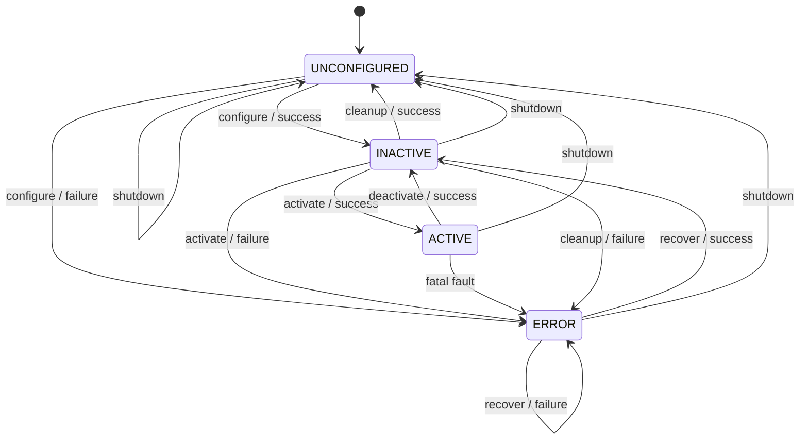
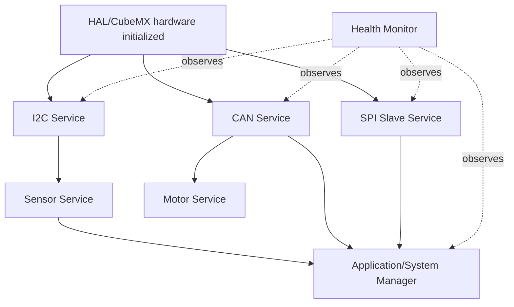
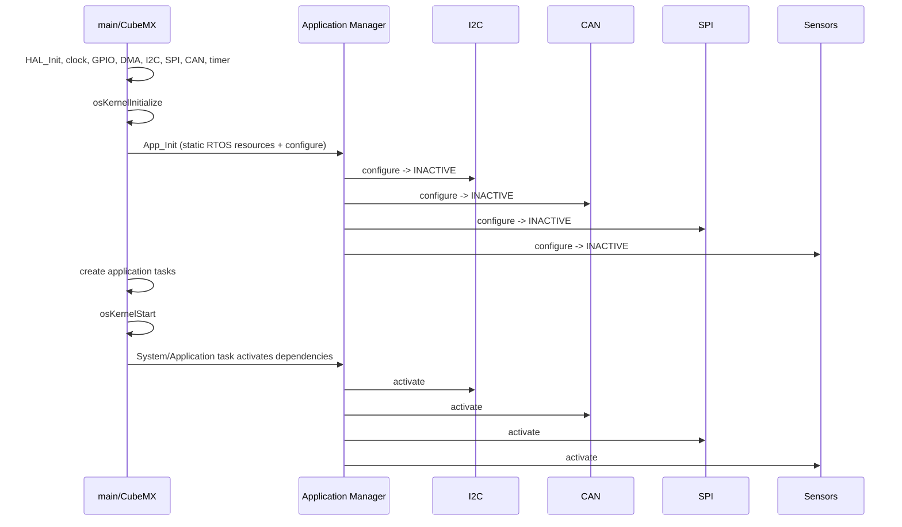

# STM32 System Lifecycle Contract

## Purpose

This document defines the lifecycle vocabulary and contract convention for the STM32 firmware and the wider robotic-arm system. It borrows the semantics of ROS 2 Managed Nodes without adding ROS 2 libraries or making STM32 subsystems into ROS 2 nodes.

The STM32 remains an independent embedded system. Lifecycle state controls readiness and safety; it does not replace peripheral state machines.

## Canonical States

| State | Meaning |
| --- | --- |
| `UNCONFIGURED` | Required configuration or resources are not ready. Normal operation is prohibited. |
| `INACTIVE` | Configuration succeeded and resources are available, but normal operational activity is deliberately disabled. |
| `ACTIVE` | Normal operation is permitted. The subsystem may perform its defined work. |
| `ERROR` | The subsystem cannot safely continue normal operation and requires recovery or reconfiguration. |

Implementation states such as `IDLE`, `BUSY_TX`, `BUSY_RX`, `TX_PENDING`, `DMA_ARMED`, `MUX_PROBE`, and `BUS_OFF_RECOVERY` remain local states. They are not system lifecycle states.

## Transitions

For every transition, the caller performs the interface-specific action first and then commits the result through the lifecycle core:

- Preconditions: current state and dependencies are valid.
- Actions: allocate/configure/start/stop/release the interface-specific resources.
- Outputs/events: update the lifecycle record and diagnostics.
- Success: transition reaches its defined target state.
- Failure: transition reaches `ERROR`, except an invalid transition which leaves the state unchanged.

`recover` always ends in `INACTIVE`; explicit activation is required afterward. `shutdown` is a safety operation, not a normal fifth state. It stops activity, preserves diagnostics, and leaves the subsystem quiescent/unconfigured.

## Fault Convention

- `INFORMATIONAL`, `DEGRADED`, `FAULT`, and `SAFETY_CRITICAL` are firmware response levels. They define detection, response, recovery ownership, and output-inhibit behavior; they are not a PL/SIL mapping or formal machine safety rating.
- Recoverable operational fault: attempt local recovery without changing lifecycle state. Example: one I2C timeout followed by a successful retry.
- Persistent fault: enter `ERROR` after the service-specific threshold or when safe operation cannot be guaranteed.
- Configuration fault: configuration or dependency failure enters `ERROR`; recovery requires correcting the cause and re-running recovery or cleanup/configure.
- `ERROR` inhibits normal outputs. A service may expose a narrowly documented safety action, such as emergency stop, only when the underlying transport is confirmed usable.

## Subsystem Mapping

| Subsystem | Classification | Lifecycle responsibility |
| --- | --- | --- |
| Application/System Manager | Lifecycle-managed coordinator | Orders configuration, activation, shutdown, and dependency checks. |
| I2C Manager | Lifecycle-dependent subsystem | Owns I2C resource readiness; internal HAL transfer states remain local. |
| CAN Service | Lifecycle-managed subsystem | Owns CAN filter/start state, MKS transport availability, and motor-command gating. |
| SPI Slave Service | Lifecycle-managed subsystem | Owns host-transfer readiness and publication enablement. |
| SensorTask/Sensor Service | Lifecycle-dependent subsystem | Requires I2C and mux readiness; sensor bring-up stages remain local. |
| Motor Service | Lifecycle-dependent subsystem | Future logical service; requires CAN `ACTIVE`. No separate implementation exists yet. |
| Health Monitor | Supporting service | Observes lifecycle and fault state; does not create readiness. |
| CubeMX/HAL setup | Hardware abstraction | Establishes hardware prerequisites before application lifecycle configuration. |

## Dependency Rules

- Sensor `ACTIVE` requires I2C and the TCA9548A path to be available.
- Motor `ACTIVE` requires CAN `ACTIVE`.
- Time-dependent motion requires valid time synchronization. Its expiry inhibits that motion while acquisition, diagnostics, and explicitly defined non-motion service operations continue.
- SPI may be `INACTIVE` while acquisition continues, but host publication must be unavailable or marked stale.
- Health Monitor may observe every state, including `ERROR` and shutdown diagnostics.
- A dependency in `UNCONFIGURED` or `ERROR` prevents dependent activation. A dependency in `INACTIVE` permits dependent configuration but not dependent activation.

## Startup and Shutdown

CubeMX peripheral initialization is hardware initialization, not lifecycle `configure`. `osKernelInitialize` precedes creation of static RTOS objects. `App_Init` is the application configuration boundary and must leave services `INACTIVE`; it may create static RTOS resources but must not activate normal operation. Task creation establishes execution context; it is not itself activation. After `osKernelStart`, a system/application task performs one dependency-ordered activation before periodic processing begins. It must not be reused as a recovery path: recovery ends in `INACTIVE` and requires a separate explicit activation request.

Shutdown order is the reverse safety order: inhibit motor commands, stop sensor acquisition, stop SPI publication, stop normal CAN transmission, preserve diagnostics, and leave peripherals safe. Lifecycle operations execute from system/task context, never from ISR context.

## C11 API

The reusable implementation is deliberately small and static:

- `App/Inc/lifecycle.h` defines states, transitions, results, and `Lifecycle_Record`.
- `App/Src/lifecycle.c` validates transition legality and updates records.
- Each service owns its record; the lifecycle core does not own HAL handles, queues, buffers, or callbacks.
- Hardware actions occur in the service. The service calls `Lifecycle_Apply()` with the action result.
- Lifecycle mutation is synchronous and task/system-context only. ISR code may signal an event; deferred service code performs the transition.
- No heap allocation, dynamic registration, event bus, inheritance, reflection, or ROS 2 dependency is used.

## Lifecycle Contract Template

Every lifecycle-managed subsystem should document:

1. **Identity**: stable subsystem name and instance.
2. **Purpose**: capability provided.
3. **Responsibilities**: decisions and resources owned.
4. **Non-responsibilities**: explicitly excluded behavior.
5. **Dependencies**: required lifecycle states of other subsystems.
6. **Lifecycle states**: canonical state mapping.
7. **Lifecycle transitions**: supported transitions and local actions.
8. **Configuration requirements**: parameters, handles, buffers, and hardware prerequisites.
9. **Activation requirements**: conditions for normal operation.
10. **Active-state behavior**: work permitted while `ACTIVE`.
11. **Deactivation behavior**: how outputs and work are stopped.
12. **Cleanup behavior**: resources released before `UNCONFIGURED`.
13. **Shutdown behavior**: deterministic safe stop and diagnostic preservation.
14. **Error conditions**: configuration, operational, and persistent faults.
15. **Recovery behavior**: local recovery, escalation threshold, and target state.
16. **Input contract**: valid callers, parameters, and timing.
17. **Output contract**: results, events, data validity, and status.
18. **Timing requirements**: transition, normal-operation, and recovery budgets.
19. **Buffer/ownership rules**: lifetime, mutability, and transfer ownership.
20. **Concurrency/RTOS rules**: task, queue, mutex, and ISR restrictions.
21. **Safety behavior**: outputs when inactive, error, or shutdown.
22. **Resource ownership**: peripheral, DMA, queue, and memory ownership.
23. **Diagnostics**: counters, timestamps, fault codes, and last transition.
24. **Complexity assessment**: why the implementation is simple or needs more machinery.
25. **Open architectural decisions**: unresolved policy choices and owners.

## Initial Interface Contracts

### I2C Manager

- Configure: create static mutex and prepare timing/diagnostics.
- Activate: permit transfers after configuration.
- Active behavior: perform blocking or asynchronous transfers through HAL.
- Internal states: `UNINITIALIZED`, `IDLE`, `BUSY_TX`, `BUSY_RX`, and hardware error remain implementation states.
- Recoverable faults: timeout or temporary NACK may retry according to I2C policy.
- Persistent faults: mark lifecycle `ERROR`; recovery must re-establish a safe bus state.

### CAN Service

- Configure: validate filters and start CAN hardware resources.
- Activate: permit normal MKS command transmission and RX processing.
- Active behavior: process RX FIFO, decode MKS frames, and run configured polling.
- Safety: normal motor commands are inhibited unless CAN is `ACTIVE`.
- Internal states: poll phase, mailbox availability, and bus-off recovery remain local.

### SPI Slave Service

- Configure: prepare static buffers, DMA, and host-transfer metadata.
- Activate: permit publication and DATA_READY signaling.
- Active behavior: publish complete frames only; partial buffers are never exposed.
- Deactivate/shutdown: stop new publication and leave DATA_READY safe.
- The SPI data protocol is a separate contract from the SPI transport service.

### Sensor Service

- Configure: prepare sensor records and required I2C/mux resources.
- Activate: permit sampling and mark data valid only after successful bring-up.
- Internal states: MUX probe, sensor probe, and sampling stages remain local.
- Persistent communication or magnet faults move the sensor to `ERROR` or `INACTIVE` according to escalation policy.

### Motor Service

- Future logical service; not currently implemented as a separate module.
- Activation requires CAN `ACTIVE`.
- Motor commands are inhibited when the service or CAN dependency is not `ACTIVE`.
- Emergency-stop policy must be explicitly defined before implementation.

### Health Monitor

- Supporting observer, not an operational dependency.
- Remains able to report lifecycle state and diagnostics during faults and shutdown.
- Must not silently activate or recover another service.

## RTOS and Timing Rules

- CubeMX hardware initialization runs before `osKernelInitialize`.
- Static RTOS object creation and application lifecycle configuration run after `osKernelInitialize` and before task creation.
- Activation, deactivation, cleanup, recovery, and shutdown run in task/system context.
- No lifecycle transition performs heavyweight work from an ISR.
- ISR callbacks remain minimal and defer state changes to service processing.
- Active operation must preserve existing service timing; lifecycle checks are bounded state queries.
- All lifecycle diagnostics and transition timestamps use the shared 64-bit monotonic time extension derived from TIM2.
- Pi-synchronized diagnostic time is valid only within the five-second TIME_SYNC validity window; otherwise diagnostics are marked unsynchronized.
- Transition and recovery timing budgets belong in each subsystem contract.

## Validation Matrix

Automated host tests are intentionally deferred from the first implementation pass. The required future cases are:

- valid configure/activate/deactivate/cleanup transitions,
- invalid activation from `UNCONFIGURED`,
- configuration and activation failure to `ERROR`,
- recovery from `ERROR` to `INACTIVE`,
- failed recovery remaining in `ERROR`,
- shutdown from every state,
- dependency activation violations,
- service command gating outside `ACTIVE`,
- fault escalation and diagnostic preservation.
