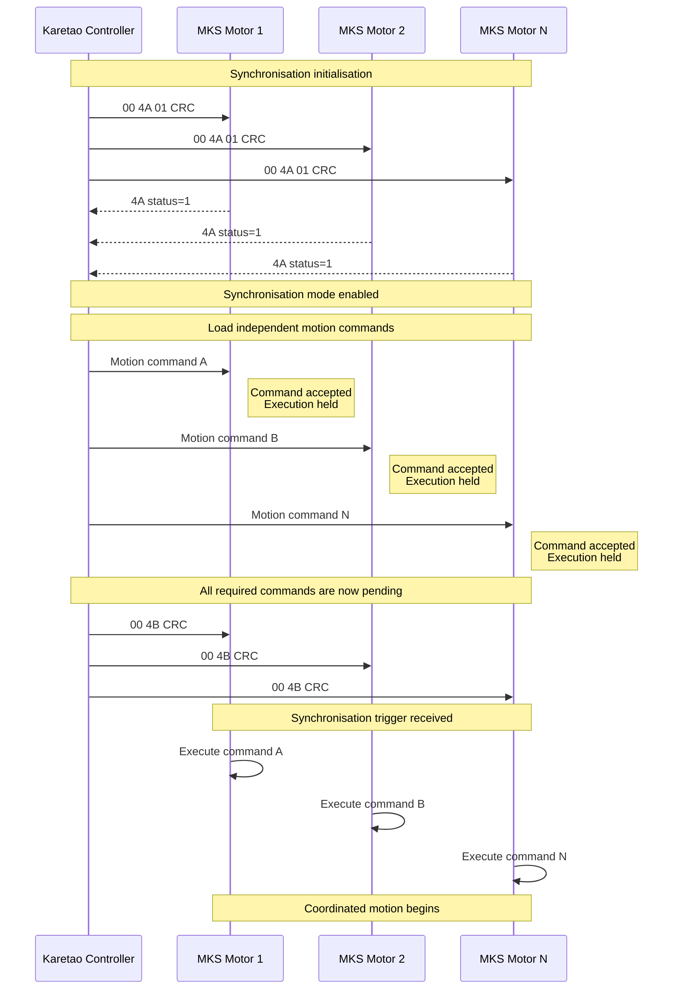

# Multi-Motor Synchronisation Using the MKS SERVO42D/57D CAN Interface
 
## 1. Introduction
 
The Karetao project requires coordinated control of multiple closed-loop stepper motors over a shared CAN bus. A key requirement is the ability to issue independent motion commands to multiple motors while ensuring that the individual motions commence at approximately the same time.
 
The MKS SERVO42D/57D CAN User Manual V1.0.9 provides a dedicated **multi-motor synchronisation-mark function** for this purpose. The mechanism differs from conventional CAN broadcast or group addressing because individual motors can receive different motion commands in advance and subsequently begin execution when a common synchronisation command is received. The manual describes this as one of three multi-motor control methods, alongside broadcast and grouped CAN control. 
 
This section documents the operation of the MKS synchronisation mechanism and evaluates its relevance to the Karetao motor-control architecture.
  
## 2. Multi-Motor Control Methods
 
The MKS manual identifies three approaches to controlling multiple motors on a shared CAN bus.
 
### 2.1 Broadcast control
 
A CAN message transmitted using CAN ID `0x00` is interpreted as a broadcast command. All motors on the bus execute the same command. The manual gives the example:
 
```text
00 FD 01 2C 02 00 0C 80 B8
```
 
This commands all motors on the bus to perform the same relative pulse movement. Broadcast control therefore provides simultaneous application of **identical commands**, but does not allow each motor to have an independent trajectory. 
 
### 2.2 Group control
 
The second method uses a configured group CAN ID. Motors assigned to the same group respond to commands addressed to that group. For example:
 
```text
50 FD 01 2C 02 00 0C 80 08
```
 
commands motors assigned to group `0x50` to perform the same movement. This provides logical grouping of motors but, like broadcast control, does not by itself provide a mechanism for different commands to be held and released simultaneously. 
 
### 2.3 Synchronisation-mark control
 
The third method is the dedicated synchronisation mechanism. The manual states that this mode allows different motors on the bus to receive **different motion commands**, while delaying their execution until a synchronisation command is received. The manual also states that this method can control an unlimited number of motors. 
 
For the Karetao project, this mechanism is the most relevant of the three when coordinated axes require independent position, speed, direction, or motion-profile commands.
  
# 3. Synchronisation-Mark Mechanism
 
## 3.1 Operating principle
 
Under normal operation, a motion command is received by a motor and execution begins immediately.
 
When the MKS synchronisation-mark function is enabled, this behaviour changes. A motor receiving a motion command does **not** immediately execute that command. Instead, the command is retained until the motor receives the synchronisation-execution command.
 
The sequence can therefore be represented as:
 
```text
                         MOTION COMMAND
                              │
                              ▼
                     ┌─────────────────┐
                     │ Receive command │
                     └────────┬────────┘
                              │
                              ▼
                     ┌─────────────────┐
                     │ Hold / buffer   │
                     │ command         │
                     └────────┬────────┘
                              │
                 Wait for 4BH synchronisation
                              │
                              ▼
                     ┌─────────────────┐
                     │ Execute motion  │
                     └─────────────────┘
```
 
The manual explicitly states that, after the synchronisation flag has been enabled, the motor waits for the synchronisation execution command before beginning the previously received motion command. 
  
# 4. Synchronisation Protocol
 
## 4.1 Enabling the synchronisation function
 
The synchronisation function is configured using command `0x4A`.
 
The command format is:
 
```text
CAN ID   DLC   Command   Enable   CRC
01       3     4A        XX       CRC
```
 
where:
 
```text
XX = 00  → synchronisation disabled
XX = 01  → synchronisation enabled
```
 
The manual defines synchronisation as disabled by default.
 
For example, the manual's multi-motor example uses:
 
```text
00 4A 01 4B
```
 
to enable synchronisation control through a broadcast command.
 
The driver returns a status indicating whether the configuration was successful. 
  
## 4.2 Loading individual motion commands
 
Once synchronisation mode has been enabled, each motor can be given its own motion command.
 
For example, the MKS manual uses two motors:
 
### Motor 1
 
```text
01 F6 02 80 02 7B
```
 
This configures Motor 1 for speed operation with:
 
 
- forward direction
- speed = 640 RPM
- acceleration = 2
 
### Motor 2
 
```text
02 FD 80 64 02 04 E2 00 CB
```
 
This configures Motor 2 for:
 
 
- relative pulse operation
- reverse direction
- speed = 100 RPM
- acceleration = 2
- 320000 pulses
 
The significant point is that these commands are **different**, yet neither motor starts its movement immediately while the synchronisation mechanism is active. 
  
# 5. Synchronisation Execution Command
 
The common execution trigger is command `0x4B`.
 
The message format is:
 
```text
CAN ID   DLC   Command   CRC
00       2     4B        CRC
```
 
The manual specifies that this is transmitted using the broadcast CAN ID `0x00`.
 
When the motor receives `0x4B`, it begins execution of the motion command previously received while synchronisation mode was active. No response message is returned for the `0x4B` command. 
 
The fundamental relationship is therefore:
 
```text
Individual commands
        │
        ├── Motor 1 → stored
        ├── Motor 2 → stored
        ├── Motor 3 → stored
        └── Motor N → stored
                  │
                  ▼
           Broadcast 4BH
                  │
                  ▼
       ┌──────────────────────┐
       │ Motors release their │
       │ stored commands      │
       └──────────────────────┘
                  │
                  ▼
       Simultaneous motion start
```
  
# 6. Sequence Diagram
 
The complete control sequence for Karetao can be represented as follows.
 

 
This diagram represents the logical operation described by Sections 12.3.1–12.3.3 of the MKS manual. 
  
# 7. Complete Example from the MKS Manual
 
The manufacturer's example provides a useful reference implementation for the Karetao software.
 

|Sequence|CAN frame|Purpose|
|---|---|---|
|1|`00 82 05 87`|Set all motors to Bus FOC mode|
|2|`00 4A 01 4B`|Enable synchronisation-mark function|
|3|`01 F6 02 80 02 7B`|Load Motor 1 motion command|
|4|`02 FD 80 64 02 04 E2 00 CB`|Load Motor 2 motion command|
|5|`00 4B 4B`|Release all synchronised motion commands|
 
The manual states that the motors subsequently begin operating synchronously according to their individual configuration parameters. 
  
# 8. Timing and Reliability Considerations
 
An important aspect of the MKS implementation is that the synchronisation trigger itself is a CAN message. Consequently, the mechanism should be understood as a **network-command-based synchronisation mechanism**, rather than a dedicated hardware timing signal.
 
The manual specifically identifies a potential issue when many motors are connected to the bus: some motors may fail to receive the synchronisation command because of interference or other communication problems. It therefore recommends repeating the `0x4B` command at approximately **1 ms intervals** when required. 
 
This has several implications for Karetao:
 
 
1. The controller should maintain a clear distinction between **command preparation** and **motion release**.
2. The controller should not assume that transmission of an individual motor command means that motion has started.
3. The `0x4B` command should be treated as the critical synchronisation event.
4. For larger motor populations, the software architecture should support retransmission of the synchronisation command.
5. The MKS documentation does not provide a numerical specification for maximum command-buffer lifetime, synchronisation jitter, or deterministic start-time error. These characteristics therefore cannot be derived from the manual and should be experimentally characterised for Karetao.
 

  
# 9. Proposed Karetao Control Architecture
 
For the Karetao system, the MKS synchronisation mechanism suggests a two-stage motion-control architecture:
 
```text
                  Karetao Motion Planner
                          │
                          ▼
                ┌─────────────────────┐
                │ Generate trajectories│
                │ for each axis        │
                └──────────┬──────────┘
                           │
                           ▼
                ┌─────────────────────┐
                │ CAN command staging │
                │                     │
                │ Axis 1 → Motor 1   │
                │ Axis 2 → Motor 2   │
                │ Axis N → Motor N   │
                └──────────┬──────────┘
                           │
                           ▼
                ┌─────────────────────┐
                │ Synchronisation     │
                │ release             │
                │      0x4B            │
                └──────────┬──────────┘
                           │
              ┌────────────┼────────────┐
              ▼            ▼            ▼
           Motor 1      Motor 2       Motor N
           execute      execute       execute
```
 
This architecture separates **trajectory preparation** from **trajectory execution**. It is particularly suitable when the Karetao controller must calculate multiple axis commands before releasing the complete motion.
  
# 10. Limitations of the MKS Documentation
 
The MKS manual establishes the functional behaviour of the synchronisation mechanism, but several engineering characteristics remain unspecified.
 
The documentation does not define:
 
 
- maximum allowable delay between receiving an individual motion command and `0x4B`;
- guaranteed synchronisation accuracy between motors;
- maximum synchronisation jitter;
- whether command buffering supports more than one pending motion command per motor;
- behaviour if a motor fails to receive its individual command;
- behaviour if `0x4B` is received before a valid motion command has been received;
- whether retransmitting `0x4B` has any side effects after motion has already started.
 

 
These should therefore be treated as **open experimental questions**, rather than assumptions in the Karetao design.
  
# 11. Conclusion
 
The MKS SERVO42D/57D provides a dedicated CAN-based synchronisation-mark mechanism for coordinated multi-motor operation. The mechanism operates by enabling synchronisation mode with command `0x4A`, transmitting independent motion commands to each motor, and then issuing the broadcast `0x4B` synchronisation command to release the pending commands. 
 
For the Karetao project, this provides a straightforward mechanism for coordinating multiple independently commanded axes without requiring every axis to use the same motion command. The principal architectural feature is the separation between **motion command reception** and **motion command execution**.
 
The key engineering consideration is that synchronisation is implemented through CAN messaging rather than a dedicated hardware trigger. Consequently, the Karetao system should experimentally characterise synchronisation latency and jitter under realistic bus loading before relying on the mechanism for applications requiring tightly bounded temporal alignment.
 
### Reference
 
Makerbase, *MKS SERVO42D/57D Closed-Loop Stepper Motor CAN User Manual V1.0.9*, Part 12, pp. 95–98. The manual identifies the synchronisation-mark mechanism, its `0x4A` configuration command, `0x4B` execution command, and the two-motor example used above.
