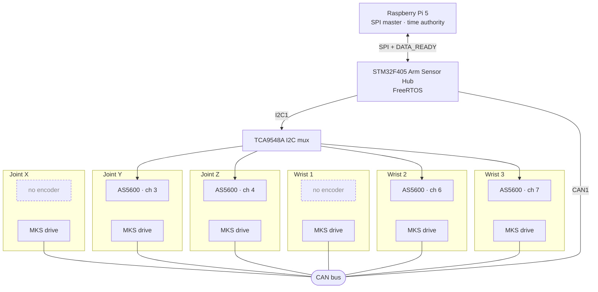

# Karetao

Karetao is my control system for a six-axis robotic arm, built as a one-person hobby project and aiming for professional embedded engineering practice. An STM32F405 sensor hub reads magnetic joint encoders and polls closed-loop stepper drives over CAN. A Raspberry Pi 5 reads that state over a CRC-checked SPI link.

**The arm is not my design.** It is the [Arctos](https://arctosrobotics.com/) V2 six-axis robotic arm by Arctos Robotics ([GitHub](https://github.com/Arctos-Robotics)), which I built. Its mechanics, the MKS drives and the drive and switch wiring come from the Arctos V2 design, and the joint names follow its convention. Karetao is my own work on top of it: the STM32 sensor hub and its firmware, the Raspberry Pi host software, the bench wiring schematic and the documentation. It does not use the Arctos firmware or Arctos Studio.

## Why Karetao

I've always been interested in robotics. When I went looking for a personal project, I found the Arctos arm: a capable six-axis design at a reasonable price. I'm using it as a platform to develop my embedded software and electronics design skills, with an STM32 as the hardware interface between the arm and the host computer.

The aim is to run a hobby project the way a professional embedded team would, at a size one person can maintain. Every requirement traces to code, tests and recorded evidence. Numbers such as bus rates and timeouts are measured before they're specified, and design decisions are written down with their reasons.

The first milestone is a sensor and motion platform I can trust: reliable joint-encoder and motor-position readings with coherent timestamps, measured link performance, and verified, gated motion on the first three joints. ROS 2 integration, motion planning and the gripper come later. Once the prototype hardware is tested and signed off, the next step is a custom carrier PCB for the STM32 and a Raspberry Pi Compute Module 5.

The project is **work in progress**. The status table below lists what runs today and what doesn't.

## System



- **Arm Sensor Hub** ([`Arm_Sensor_Hub/`](Arm_Sensor_Hub/)): C11 firmware on FreeRTOS (CMSIS-RTOS2), built with CMake and Ninja. Sensor and CAN tasks write latest-value stores. A snapshot builder assembles them, and an SPI slave service serves framed snapshots over DMA with a DATA_READY line. Lifecycle, health-monitor and motion-permission modules gate that behaviour.
- **Raspberry Pi host** ([`RaspberryPi_Sensor_Hub/`](RaspberryPi_Sensor_Hub/)): standard-library Python. It has the SPI master, the frame codec, and probe and timing tools that measure the link on the bench.
- **Bench wiring** ([`Hardware/bench-wiring/`](Hardware/bench-wiring/)): a connector-level KiCad schematic of the whole bench, down to each drive's motor and its home and limit switches ([PDF](Hardware/bench-wiring/karetao_bench_wiring.pdf)). A Python script generates it and checks its connectivity, and KiCad's electrical rules check reports no errors or warnings. [`BRING_UP.md`](Hardware/bench-wiring/BRING_UP.md) is the phased bring-up checklist that goes with it.
- **SPI protocol:** an 18-byte little-endian header (magic `0xA55A`), a CRC-32 trailer and frames of at most 512 bytes. It is implemented twice, in [`spi_protocol.c`](Arm_Sensor_Hub/App/Src/spi_protocol.c) and [`spi_protocol.py`](RaspberryPi_Sensor_Hub/src/spi/spi_protocol.py), and the two are tested against the same contract ([`Documentation/02_INTERFACES/SPI/`](Documentation/02_INTERFACES/SPI/)).

## Status (2026-10-15)

| Area | State |
|---|---|
| SPI framing and CRC, C and Python | Implemented, unit-tested on both sides |
| SPI3 DMA slave path with DATA_READY | Implemented; VERSION request decoded live by the Pi probe |
| Encoder sweep through the I2C mux | Implemented for six axes; four encoders are fitted, and axes 0 and 3 report NOT_FITTED. A full sweep measured about 46 ms on the bench (2026-09-17) |
| Lifecycle (UNCONFIGURED/INACTIVE/ACTIVE/ERROR) and health monitor | Implemented, host-tested |
| CAN polling of MKS drives | Scaffold; one motor registered (axis 0, SERVO57D). All six drives' models and CAN IDs (0x001 to 0x006) are recorded |
| Joint motion | Initial movement seen on three joints; not yet recorded as evidence |
| **Snapshot over SPI** | **Not working yet.** The snapshot staging functions exist and are tested, but nothing in the firmware calls them, so GET_SNAPSHOT returns only an ACK |
| **CAN bitrate** | **Wrong.** The generated configuration runs at 187.5 kbit/s, which isn't a rate the MKS drives support; some documents still say 875 kbit/s |
| Motion-permission gate and motor command path | `motion_permission.c` is written but not yet in the build; the SET_MOTOR_COMMAND path isn't implemented |
| Motor control design | Decided, not yet in code: F5H absolute-position and F6H velocity commands with 31H position feedback; SR_CLOSE drive mode (Provisional, pending a holding check); MKS multi-drive synchronised start in development ([decisions](Documentation/07_DECISIONS/ARCHITECTURE_DECISIONS.md)) |
| Clock synchronisation | The code runs an older one-way TIME_SYNC; the [redesign](Documentation/07_DECISIONS/ISSUE_12_CLOCK_SYNCHRONIZATION_DECISIONS.md), in which the Pi models the clock, isn't implemented |
| System verification | No requirement is `SYSTEM_VERIFIED` yet ([matrix](Documentation/05_VERIFICATION/SYSTEM_VERIFICATION_MATRIX.md)) |

A full code-against-documentation review on 2026-10-14 found these gaps. The next stage fixes them, starting with the snapshot path and the CAN bit timing, before bench verification of the first three joints.

## Build and test

Requirements: CMake 3.22+, Ninja, `arm-none-eabi-gcc` for the firmware, a native C compiler for the host tests, and Python 3.12.

From `Arm_Sensor_Hub/`:

```bash
cmake --preset Debug && cmake --build --preset Debug          # firmware: build/Debug/Arm_Sensor_Hub.elf
cmake --preset HostTests && cmake --build --preset HostTests && ctest --preset HostTests --output-on-failure
```

The host tests compile the application modules natively against FreeRTOS and HAL stubs ([`tests/host/`](Arm_Sensor_Hub/tests/host/)).

From the repository root:

```bash
python -m unittest discover -s RaspberryPi_Sensor_Hub/tests/spi -p 'test_*.py' -v
```

CI ([`.github/workflows/`](.github/workflows/)) runs these same commands on every push.

## Engineering approach

- **Requirements to evidence.** System requirements (`SYS-*`) trace to code modules, then to tests, then to bench evidence records in the [verification matrix](Documentation/05_VERIFICATION/SYSTEM_VERIFICATION_MATRIX.md). Nothing counts as verified on unit tests alone.
- **Measure before specifying.** Every numeric value (SPI clock, CAN bitrate, poll periods, timeouts) lives in one [parameter register](Documentation/06_CONFIGURATION/PARAMETER_REGISTER.md), and each value is labelled Measured, Datasheet, Derived or Provisional.
- **Recorded decisions.** Architecture decisions and open questions are in [`Documentation/07_DECISIONS/`](Documentation/07_DECISIONS/). Scope and non-goals are in the [project charter](Documentation/01_SYSTEM/PROJECT_CHARTER.md).
- **Regenerable vendor code.** CubeMX output (`Core/`, `Drivers/`) is kept separate from application code in `App/`, so the hardware configuration can be regenerated without merge pain.

Start at [`Documentation/00_INDEX.md`](Documentation/00_INDEX.md) for the full documentation set.

## How this is built

I set the scope, architecture, requirements and hardware design, and I do all bench work. AI coding agents (Claude Code and GitHub Copilot) write much of the implementation and documentation from briefs I write, and I review every change before it merges. The `AIKaretao` and Copilot commit authors are those agents. The working process, from brief through plan, design review, build, verification and delivery, runs through a separate tool of mine. Its project configuration, work packages and backlog are in [`icm-project/`](icm-project/README.md); `portal.toml` stays at the root because the tool reads it there.

## Layout

| Path | Contents |
|---|---|
| `Arm_Sensor_Hub/` | STM32F405 firmware: `App/` application modules, CubeMX `Core/` and `Drivers/`, the MKS servo library, host tests |
| `RaspberryPi_Sensor_Hub/` | Pi SPI master, protocol codec, bench measurement tools, tests |
| `Hardware/` | Bench wiring schematic (KiCad, generated by `generate_schematic.py`) and bring-up checklist |
| `Documentation/` | System requirements, interfaces, safety, configuration, verification and decisions |
| `icm-project/` | Vendor reference summaries, project tooling (including the documentation checker), and the work-package and backlog records |
| `shared/` | Placeholders for shared protocol code and test vectors |

## Licence

Apache License 2.0 ([`LICENSE`](LICENSE)). Vendor code keeps its own licence: the STM32 HAL and CMSIS under `Arm_Sensor_Hub/Drivers/` and FreeRTOS under `Arm_Sensor_Hub/Middlewares/Third_Party/FreeRTOS/`, each with the licence file in its folder.
